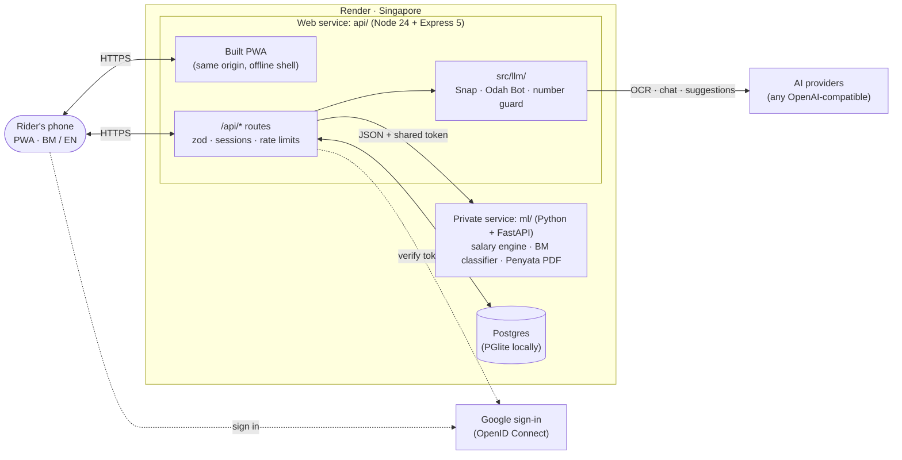
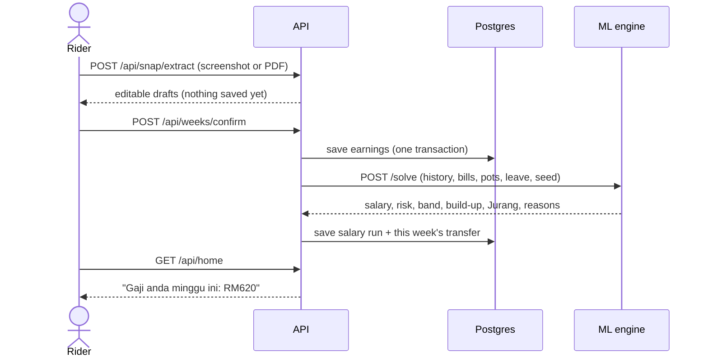
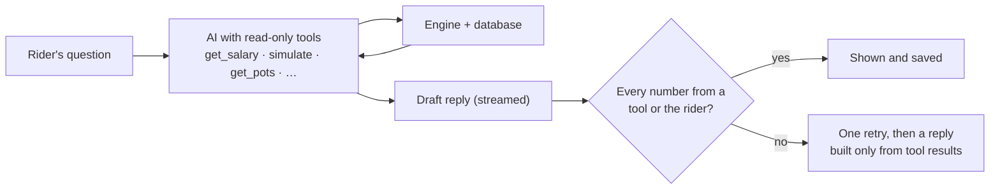

<p align="center">
  
</p>

<h1 align="center">Coinvoy</h1>

<p align="center">
  <b>Tiada majikan? Coinvoy beri apa yang majikan beri.</b><br>
  <sub>("No employer? Coinvoy gives you what an employer gives.")</sub><br>
  A steady weekly salary, payslips, contributions, paid leave and an advisor for Malaysian gig riders, using only their own money.
</p>

<p align="center">
  
  
  
  
</p>

<p align="center"><sub>built with</sub></p>

<p align="center">
  
  
  
  
  
  
</p>

<p align="center">
  
  
  
  
  
</p>

<p align="center">
  
  
  
  
  
  
</p>

<p align="center"><sub>UTP CodeFest '26 · Track 5: Finance (Financial Inclusion)</sub></p>

---

## Contents

1. [The problem](#the-problem)
2. [Our solution](#our-solution)
3. [Objectives and what Coinvoy achieves](#objectives-and-what-coinvoy-achieves)
4. [Getting started](#getting-started)
5. [Architecture](#architecture)
6. [API reference](#api-reference)
7. [How the salary engine works](#how-the-salary-engine-works)
8. [Results (honest status)](#results-honest-status)
9. [Security](#security) · [Privacy (PDPA)](#privacy-pdpa) · [Legal positioning](#legal-positioning)
10. [Deployment](#deployment)
11. [Contributing](#contributing) · [License](#license) · [Team](#team-ai-dont-know)

---

## The problem

**CodeFest 2026, Track 5: Finance (Financial Inclusion).** The brief names B40 families, **gig economy workers**, the rural population, street vendors and micro-SMEs as the groups financial services still leave behind. Digital finance reached 63% of Malaysians in 2023, yet many still struggle to access financial products, manage their money and spot financial risks online. The brief asks for fintech that makes money management easier, builds financial literacy and opens access to financial services.

We focus on **gig riders** (food delivery and e-hailing: Grab, foodpanda, ShopeeFood, Lalamove):

<div align="center">

| Fact | Source |
|---|---|
| About **1.64 million** Malaysians earned income from gig work at the end of 2025 | [The Star, Jul 2026](https://www.thestar.com.my/business/business-news/2026/07/11/hailstorm-over-rides) |
| Driver groups say net earnings are **down 30–50%** compared with 3–4 years ago | [The Star, Jul 2026](https://www.thestar.com.my/business/business-news/2026/07/11/hailstorm-over-rides) |
| A "significant majority" of e-hailing and delivery drivers have **no emergency or retirement savings** | [SAYS / The Centre](https://says.com/my/news/a-risky-gig-majority-of-m-sian-e-hailing-delivery-drivers-have-no-insurance-or-savings) |
| The **Gig Workers Act 2025** is in force (31 Mar 2026), making social security contributions mandatory | [NST](https://www.nst.com.my/amp/news/nation/2026/03/1403257/better-protection-gig-workers-under-new-law) |
| Budget 2026 **i-Saraan Plus** gives gig workers up to **RM600 a year** in EPF matching | [Malay Mail](https://www.malaymail.com/news/malaysia/2025/10/10/budget-2026-gig-workers-to-get-up-to-rm600-a-year-in-epf-matching-under-new-i-saraan-plus-scheme/194145) |

</div>

An employee gets five things a gig rider doesn't:

<div align="center">

| What an employer gives | What a gig rider has today |
|---|---|
| **Steady pay** on a fixed day | RM900 one week, RM400 the next |
| **A payslip** to show a bank or landlord | Screenshots, nothing official |
| **Contributions** (EPF, PERKESO) set aside automatically | Has to remember to pay them; most don't |
| **Paid leave**, so Raya or illness doesn't mean losing pay | Every day off is a day without pay |
| **Someone to ask** about money | Nobody, and loan sharks in WhatsApp |

</div>

The problem has two parts. **Uneven income:** good weeks get spent and bad weeks hurt. **Low income:** riders earn less than before, and no app can add money that isn't there. Coinvoy fixes the first and shows the second honestly.

**Why existing tools fall short:** budgeting apps assume a fixed salary and look backwards; banks want payslips riders don't have; earned-wage advances are lending, with fees and debt risk; platform savings features cover one platform when most riders work two or three; and the EPF/PERKESO portals leave the rider to remember and act alone.

## Our solution

**Coinvoy is a payroll department for one person.** It gives a rider the five things an employer gives, **using only their own money**: it never lends, never holds funds, and is not a credit score.

<div align="center">

| Benefit | What the rider gets |
|---|---|
| **Gaji Tetap** (steady pay) | One weekly salary that is safe in 95% of 1,000 simulated futures. Good week: "Pindah RM168 ke poket Penampan" (move RM168 into your buffer pocket); lean week: take it back out. The rider moves the money in their own bank and taps **Dah pindah** (done). The buffer counts confirmed transfers only. |
| **Slip Gaji** (payslip) | Weekly payslips and a Penyata income statement PDF, every figure labelled *Dilapor sendiri* or *Disemak silang* (self-reported or cross-checked against a bank statement), plus a revocable read-only link for a loans officer. |
| **Caruman** (contributions) | i-Saraan set-asides with a "government money claimed" counter; PERKESO shown as deducted at source. |
| **Cuti Berbayar** (paid leave) | Plan Raya leave, set a little aside each week, and the week off still pays. Sick days are covered too. |
| **Penasihat** (advisor) | **Odah Bot** (a chatbot where every number must come from the engine), **Semak Layak** (can I afford this instalment?), **Semak Pemberi Pinjaman** (a lender check against BNM's alert list), **Semak Mesej** (a scam message check), **Jurang** (an honest view when income is too low) and **Celik** lessons. |

</div>

**Getting money in takes seconds.** **Snap** reads an earnings screenshot or a platform's PDF statement into an editable draft; nothing is saved until the rider confirms. Grab's weekly statement is read with exact rules, and everything else by an AI. Costs are typed or spoken in BM ("isi minyak empat puluh") and parsed by our own rules and classifier first. **Tabung** (pots) holds the buffer and the rider's own goals, with suggestions worked out from their data.

**Why it isn't a budgeting app:** budgeting apps look back at what you spent; Coinvoy looks forward, simulates your next 12 weeks, and moves real money between them so a good week pays for a bad one.

## Objectives and what Coinvoy achieves

<div align="center">

| # | Objective | How Coinvoy delivers it | How we measure it |
|---|---|---|---|
| G1 | Riders have enough money more weeks | A steady salary from a 1,000-future simulation, recalculated weekly | Share of weekly check-ins answered "Ya" (the north star) |
| G2 | A real buffer gets built | Transfer instructions; the buffer counts only confirmed transfers | RM confirmed into pockets; buffer in weeks of cover |
| G3 | Riders can take paid leave | Cuti pot pays the salary in leave weeks | Leave weeks paid from the pot |
| G4 | Riders claim what they're entitled to | i-Saraan set-asides and the match counter | i-Saraan Plus match earned (RM) |
| G5 | Riders can prove their income | Payslips, the Penyata PDF and officer links | Statements and officer links issued |
| G6 | The engine's promise holds | 95% safety target, walk-forward backtest | Buffer below zero in ≤ 5% of real weeks |
| G7 | Usable in natural BM on a cheap phone | Bilingual PWA, ≤ 300 KB first load, a weekly ritual under a minute | Ritual time; usability tests with riders |

</div>

**Track 5 fit:** easier money management (Gaji Tetap, Tabung, Snap), financial literacy (Odah Bot, Celik, the ⓘ explanations of commission and flat rates), access to financial services (the Penyata for loans and rentals, Semak Layak before borrowing) and protection from online financial risk (the lender and scam message checks). **BM NLP bonus:** our own BM cost parser and classifier.

**Permanent boundaries (by design, not cuts):** Coinvoy never moves or holds money, never lends or gives advances, never builds a credit score or sells data, and never reads SMS or other apps.

---

## Getting started

This is a **monorepo**: one repository, one `.env` and one command start all three parts.

<div align="center">

| Folder | What | Language |
|---|---|---|
| `frontend/` | The app (a PWA) | TypeScript, React |
| `api/` | The API, which also serves the built app | TypeScript, Node + Express |
| `ml/` | The salary engine, BM classifier and PDF renderer | Python, FastAPI |

</div>

The `frontend` and `api` packages are a [pnpm workspace](https://pnpm.io/workspaces) (`pnpm-workspace.yaml`); `ml` is a [uv](https://docs.astral.sh/uv/) project. Run every command **from the repo root**.

### 1. Prerequisites

<div align="center">

| Tool | Version | Install |
|---|---|---|
| Node.js | 24.x | [nodejs.org](https://nodejs.org) or `nvm install 24` |
| pnpm | 12.x (pinned in `package.json`) | `corepack enable` |
| Python | 3.12+ | [python.org](https://www.python.org) (uv can install it for you) |
| uv | latest | [docs.astral.sh/uv](https://docs.astral.sh/uv/getting-started/installation/) |

</div>

No database to install: locally the API uses an embedded Postgres (PGlite) stored in `api/.pglite`.

### 2. Install and run

```bash
git clone https://github.com/No0bmazt3r/Coinvoy.git
cd Coinvoy
pnpm bootstrap          # installs the web app and API (pnpm) and the ML service (uv)
cp .env.example .env    # optional: AI keys and Google sign-in (the demo works without them)
pnpm dev                # API :8000 · ML service :8001 · app http://localhost:5173
```

Open http://localhost:5173 and tap **Cuba demo**. You land on Abang Faiz's account (12 weeks of labelled synthetic data) with a working salary. The second demo button opens Kak Lina, whose safe salary is below her essentials, so the app shows Jurang. Snap and Odah Bot need an AI key; everything else works without one.

### 3. Configuration (`.env`)

Every setting is documented in [`.env.example`](.env.example). Only the API reads it. To run locally, the only things you might add are:

<div align="center">

| Variable | Needed for |
|---|---|
| `LLM_API_KEY` (or `LLM_API_KEY_SNAP` / `_TANYA` / `_RECO` with `LLM_SPLIT_KEYS=true`) | Snap (OCR), Odah Bot (chatbot), pot suggestions |
| `GOOGLE_CLIENT_ID`, `GOOGLE_CLIENT_SECRET` | Google sign-in (the demo login works without it) |
| `ADMIN_EMAILS` | The `/admin` usage page |

</div>

**Any OpenAI-compatible AI provider works.** Groq, Gemini, OpenRouter, OpenAI, Mistral, Ollama and others: set a base URL, key and model per job (the list of base URLs is in `.env.example`). Switching provider is never a code change. Before sending real rider data, check the provider's data terms: Groq offers zero data retention, while Gemini's **free** tier may use prompts to improve Google's products.

### 4. Commands

<div align="center">

| Command | What it does |
|---|---|
| `pnpm dev` | Starts the API, the ML service and the web app together |
| `pnpm check` | Lint, typecheck, all tests and the production build (what CI runs) |
| `pnpm test` | ML (pytest) + API (vitest, against the real ML service) + web tests |
| `pnpm preview:prod` | Builds the app and serves the **production build** at http://localhost:8000 (the dev build is several times slower) |
| `pnpm db:generate` | Writes a SQL migration from `api/src/db/schema.ts` (applied when the API starts) |
| `pnpm train:bm` | Regenerates the seed phrases and retrains the BM cost classifier |
| `pnpm train:rate <csv>` | Trains the pooled rate model (`--synthetic N` for a dry run) |
| `pnpm icons` | Regenerates the app icons from `public/Coinvoy.png` |

</div>

**Browse the local database:** while `pnpm dev` runs, connect DBeaver or `psql` to `postgres://postgres@127.0.0.1:5433/postgres` (`PGLITE_PORT` in `.env`).

**Google sign-in:** create an OAuth client of type *Web application* in Google Cloud Console with origin `http://localhost:5173` and redirect URI `http://localhost:5173/api/auth/google/callback`, then put its ID and secret in `.env`.

### 5. Repository layout

```
Coinvoy/
├── frontend/                 React 19 PWA: src/routes (screens), src/components, src/lib, src/i18n (ms.json, en.json)
├── api/
│   ├── src/routes/           HTTP: zod validation, auth, status codes
│   ├── src/services/         rules and orchestration (salary, pots, penyata, reco, scam, …)
│   ├── src/llm/              AI client, Snap, Odah Bot (`tanya.ts`), the number guard, prompts/*.md
│   ├── src/db/               Drizzle schema (every table), Postgres or PGlite
│   ├── drizzle/              SQL migrations, applied at startup
│   └── test/                 vitest suites (fake AI provider, real ML service)
├── ml/
│   ├── app/engine/           forecast, simulation, salary search, Malaysian calendar
│   ├── app/nlp/              BM parser and classifier
│   ├── app/render/           Penyata PDF and officer page
│   ├── scripts/              training, backtest, evaluation
│   └── tests/                pytest
├── render.yaml               deployment blueprint (Render, Singapore)
├── .github/                  CI, issue and PR templates, CODEOWNERS
└── .env.example              one .env at the root for everything
```

---

## Architecture

### System



- **One origin.** The API serves the built app, so the session cookie is first-party and there's no CORS.
- **The ML service is private and stateless.** It has no database, users or AI; the API sends a rider's data as JSON and stores what comes back.
- **The AI reads and talks; code computes.** Every number a rider sees comes from the engine or the database.

### Confirming a week → a new salary



### Odah Bot and the number guard



The reply streams word by word, but a word is only shown once the guard has passed it.

### Tech stack

<div align="center">

| Layer | Choice |
|---|---|
| App | React 19, TypeScript, Vite, TanStack Router + Query, Tailwind v4, hand-written service worker |
| API | Node 24 (runs `.ts` directly), Express 5, zod, Drizzle ORM |
| Database | Postgres in production, PGlite (Postgres in WASM) locally and in tests |
| ML service | Python 3.12, FastAPI, NumPy, scikit-learn, WeasyPrint, pypdf |
| AI | `openai` SDK against any OpenAI-compatible provider, a key and model per job |
| Auth | Google OpenID Connect (code flow + PKCE) and One Tap; server-side sessions |
| Tests and CI | vitest, supertest, pytest; GitHub Actions (lint, types, tests on PGlite and real Postgres, bundle budget, gitleaks) |
| Hosting | Render, Singapore: web service + private ML service + Postgres, no Docker |

</div>

---

## API reference

All routes are under `/api` and return JSON. Errors look like `{ "error": { "code", "message_ms", "message_en" } }`. Money is in **integer sen**; weeks are ISO weeks given as their Monday (`YYYY-MM-DD`, Asia/Kuala_Lumpur). Every rider route needs a session cookie and only ever reads that rider's data.

<details>
<summary><b>Auth and account</b></summary>

<div align="center">

| Method | Path | What it does |
|---|---|---|
| GET | `/api/auth/google` | Starts Google sign-in (redirect) |
| GET | `/api/auth/google/callback` | Google redirects back here; creates the session |
| GET · POST | `/api/auth/google/one-tap` | Google One Tap sign-in |
| POST | `/api/auth/demo` | Creates a temporary demo rider (`?persona=lina`, `?empty`) |
| POST | `/api/auth/logout` | Ends the session |
| GET | `/api/auth/me` | The signed-in rider, or 401 |
| PATCH | `/api/me` | Update profile and settings |
| POST · DELETE | `/api/tips` | Mark screen guides as seen / reset them |
| POST | `/api/consents` | Record a consent (privacy, AI processing, Rider Index) |
| GET | `/api/me/export` | Download all of the rider's data (JSON) |
| DELETE | `/api/me` | Delete the account and every row |

</div>

</details>

<details>
<summary><b>Earnings, bills and costs</b></summary>

<div align="center">

| Method | Path | What it does |
|---|---|---|
| POST | `/api/snap/extract` | Screenshots or PDFs in (multipart, 1–5 files), editable drafts out |
| POST | `/api/weeks/confirm` | Save confirmed weeks and recalculate the salary |
| GET | `/api/weeks` | Logged weeks, per platform |
| PATCH · DELETE | `/api/earnings/:id` | Edit or remove one platform's week |
| GET · POST | `/api/bills` | List or add bills |
| PATCH · DELETE | `/api/bills/:id` | Edit or remove a bill |
| POST | `/api/expenses/parse` | "minyak 40" → amount and category (rules, our classifier, then AI) |
| GET · POST | `/api/expenses` | List or add costs |
| DELETE | `/api/expenses/:id` | Remove a cost |
| POST | `/api/statement` | Cross-check against a bank or e-wallet statement PDF |

</div>

</details>

<details>
<summary><b>Salary, pots and transfers</b></summary>

<div align="center">

| Method | Path | What it does |
|---|---|---|
| GET | `/api/home` | This week's salary, transfer, buffer, streak and to-dos |
| POST | `/api/transfers/:id/confirm` | "Dah pindah": the money really moved (full or partial) |
| GET | `/api/pots` | All pots and balances |
| GET | `/api/pots/penampan/history` | Buffer balance after each confirmed transfer (chart) |
| GET | `/api/pots/suggestions` | Suggested pots (rules, ordered and worded by AI when allowed) |
| POST | `/api/pots/classify` | Category for a rider's own pot name |
| POST | `/api/pots/preview` | What a weekly set-aside does to the salary |
| POST | `/api/pots` | Add a pot |
| PATCH | `/api/pots/:kind` | Change a pot's target or weekly amount |
| POST | `/api/pots/:kind/close` | Close a pot (its money moves to the buffer) |

</div>

</details>

<details>
<summary><b>Benefits: leave, contributions, streaks</b></summary>

<div align="center">

| Method | Path | What it does |
|---|---|---|
| POST | `/api/leave/preview` | What planned leave costs per week |
| GET · POST | `/api/leave` | List or plan leave |
| POST | `/api/leave/sick` | Use sick days |
| DELETE | `/api/leave/:id` | Cancel planned leave |
| GET | `/api/caruman` | i-Saraan and PERKESO status |
| POST | `/api/caruman/isaraan` | Record an i-Saraan contribution |
| POST | `/api/checkins` | Weekly "did you have enough?" answer |
| GET | `/api/streak` | Streak weeks and level |
| POST | `/api/streak/freeze` | Use a streak freeze |
| GET | `/api/index` | Rider Index (anonymous rates, groups of 20+ only) |

</div>

</details>

<details>
<summary><b>Advisor: Odah Bot and the checks</b></summary>

<div align="center">

| Method | Path | What it does |
|---|---|---|
| GET | `/api/tanya/messages` | Chat history (kept 90 days) |
| POST | `/api/tanya/messages` | Ask Odah Bot; `?stream=1` streams one JSON event per line (`text`, `reset`, `done`, `error`) |
| DELETE | `/api/tanya/messages` | Clear the chat |
| POST | `/api/layak` | Semak Layak: can I afford this instalment? |
| POST | `/api/lender-check` | Check a loan offer (red flags, rate cap, BNM alert list) |
| POST | `/api/scam-check` | Check an SMS or WhatsApp message for scam signs |
| GET | `/api/jurang` | The honest gap view and three options |
| GET | `/api/celik` | Short lessons using the rider's numbers |

</div>

</details>

<details>
<summary><b>Records, reminders, admin and public</b></summary>

<div align="center">

| Method | Path | What it does |
|---|---|---|
| GET | `/api/payslip/:week` | One week's payslip |
| GET | `/api/penyata` · `/api/penyata.pdf` | Income statement summary and PDF |
| GET · POST | `/api/officer-links` | List or create read-only links for a loans officer |
| DELETE | `/api/officer-links/:id` | Revoke a link |
| GET | `/o/:token` | The officer's read-only page (no sign-in, expires) |
| GET · POST · DELETE | `/api/push` | Payday reminder subscription |
| POST | `/api/push/test` | Send a test reminder |
| GET | `/api/admin/usage` | Usage counts, retention, AI cost (`ADMIN_EMAILS` only; 404 otherwise) |
| GET | `/api/health` | Health check |
| GET | `/api/meta` | Public facts for the privacy page (AI provider, region, contact) |

</div>

</details>

<details>
<summary><b>ML service (private, called only by the API)</b></summary>

<div align="center">

| Method | Path | What it does |
|---|---|---|
| POST | `/solve` | The safe weekly salary and its explanation |
| POST | `/p-safe` | How safe a given salary is under a scenario |
| POST | `/jurang` | The gap and the three options |
| POST | `/leave-preview` | Leave set-aside per week |
| POST | `/bm/parse` | BM cost phrase → amount and category |
| POST | `/penyata` | Render the Penyata (HTML or PDF) |
| POST | `/statement/text` | A statement PDF's text lines |
| GET | `/health` | Health check |

</div>

</details>

---

## How the salary engine works

**The salary.** Income is forecast as rate × hours: the rider's own average RM per hour, shrunk toward a population prior when there are few weeks. The engine simulates 1,000 12-week futures with a **block bootstrap** (runs of 4 consecutive weeks, so bad spells stay together), subtracts bills, contributions and leave set-asides in the weeks they fall due, and searches for the largest whole-ringgit salary that keeps the buffer at or above zero in at least 95% of futures. While the buffer is below 2 weeks of essentials, it also has to reach that target within about 8 weeks. Same rider, same week, same seed: the number doesn't jitter.

**The Malaysian calendar.** Ramadan, public holidays and school holidays (`ml/app/engine/data/calendar_my.json`) are features of every week: past weeks have their season effect taken out before fitting, and future weeks get theirs put back, so a Raya week isn't mistaken for a slump. A pooled gradient-boosted rate model can replace the shrinkage mean, but stays off until it beats it on real histories.

**The AI is fenced in.** Every number Odah Bot says is checked by plain code against the tool results and the rider's own message (`api/src/llm/guard.ts`). Snap and the lender check have no tools and must answer in a schema; text inside a screenshot is data, never instructions.

**BM NLP, our own.** Cost phrases go through rules (BM number words like "dua ratus lima puluh", "rm40", "1.5k"), then our TF-IDF + logistic regression classifier (`ml/app/nlp/`), and only reach the AI when both are unsure. A number the rules found always wins.

## Results (honest status)

<div align="center">

| What | Status |
|---|---|
| Walk-forward backtest (`ml/scripts/backtest.py`) | **Dry run on 30 synthetic riders only**: Coinvoy ran short in 0.0% of 660 replayed weeks vs 1.2% for "4-week average − 20%", at a higher median salary (RM594 vs RM511). Synthetic data follows the engine's own assumptions, so this is **not evidence**; a real-data run comes after launch. |
| Pooled rate model | **Synthetic dry run only**; off by default (`RATE_MODEL`). |
| Calendar data | Transcribed from the official calendars but **not yet checked line by line** (`verified: false`); season effects are team estimates. |
| BM classifier (`ml/app/nlp/artifacts/model_card.md`) | Trained on 770 **synthetic seed** phrases; no real-world accuracy figure yet. |
| Snap accuracy (`api/scripts/eval-snap.ts`) | Script ready; needs labelled real screenshots. |
| Cost per rider (`api/scripts/llm-cost-report.ts`) | Script ready; needs real usage and a dated price table. |

</div>

## Security

<div align="center">

| Threat | What stops it |
|---|---|
| Account takeover | Google sign-in only (OIDC code flow with state, PKCE S256 and nonce), no passwords; server-side sessions storing only a SHA-256 of the token; httpOnly SameSite cookie; 7-day expiry |
| Seeing another rider's data | Every query is scoped to the signed-in rider; tests check that another rider's IDs return 404 |
| Cross-site requests | SameSite cookie + an Origin check on every unsafe request |
| Made-up numbers from the AI | The number guard, tested |
| Prompt injection via a screenshot or pasted text | No tools on those routes, schema-only output, clear delimiters; tested with an injected screenshot |
| Runaway AI costs | Per-rider daily limits and a monthly call cap; manual entry always works |
| Leaked keys | Secrets only in env vars; `.env` and OAuth client files git-ignored; gitleaks in CI |
| Officer link leakage | Random 128-bit tokens stored hashed, 7-day expiry, revocable (410), noindex |
| Brute force | Rate limit on the auth routes; CSP, nosniff and Referrer-Policy headers |
| Secrets in logs | Request logs carry method, path, status, time and rider ID only; officer tokens are masked |

</div>

Found a vulnerability? Please report it privately: see [SECURITY.md](SECURITY.md).

## Privacy (PDPA)

Screenshots and statement PDFs are read in memory and **never stored**; EXIF is stripped first. Riders consent to the privacy notice and, separately, to AI processing, which they can switch off in Profil. The privacy page is a layered notice in BM and English that names the AI providers and where they process data. Odah Bot messages are deleted after 90 days and demo accounts after 24 hours. Riders can download all their data or delete their account (every row cascades) from Profil. The Rider Index is opt-in, stores no user ID, and shows nothing for groups under 20.

## Legal positioning

<div align="center">

| Topic | Position |
|---|---|
| Lending | None. No loans, advances or earned-wage access. The money is always the rider's own. |
| Holding funds | Never. Pockets belong to the rider's licensed bank or e-wallet; Coinvoy only tracks earmarks. |
| Credit reporting | Not a credit score; the rider shares only their own statement and the lender decides. |
| Financial advice | Information from the rider's own data, labelled as an estimate; the rider decides. |
| Lender check | States facts ("appears on BNM's alert list, copy dated …"), never accusations; points to KPKT's licence check. |
| Rates and schemes | i-Saraan match, PERKESO rate and moneylender caps are configuration, to be verified against official sources. |

</div>

---

## Deployment

Coinvoy deploys as **one Render Blueprint** ([`render.yaml`](render.yaml)) in Singapore, with no Docker:

<div align="center">

| Render resource | What runs there |
|---|---|
| Web service `coinvoy` | The API **and** the built app (one origin) |
| Private service `coinvoy-ml` | The Python ML service, reachable only from the API |
| Postgres `coinvoy-db` | The database; migrations run when the API starts |

</div>

1. Push to GitHub, then in Render choose **New → Blueprint** and pick this repository. Render creates all three and wires `DATABASE_URL`, `ML_URL` and a shared `ML_TOKEN`.
2. Fill in the secrets Render asks for (`APP_URL`, Google client, AI keys, `PRIVACY_CONTACT_EMAIL`, VAPID keys, `ADMIN_EMAILS`).
3. In Google Cloud Console, add `https://<your-domain>` as an origin and `https://<your-domain>/api/auth/google/callback` as a redirect URI.

There is no separate frontend deploy: the web service builds the app and serves it.

---

## Contributing

Contributions are welcome. Read [CONTRIBUTING.md](CONTRIBUTING.md) for setup, branch and commit conventions and what CI checks, and follow our [Code of Conduct](CODE_OF_CONDUCT.md). Please don't open public issues for security problems; see [SECURITY.md](SECURITY.md).

## License

[MIT](LICENSE) © 2026 Sharvin A/L Kanesan and the AI Don't Know team.

## Team: AI Don't Know

<div align="center">
<table>
  <tr>
    <td align="center" width="25%"><br><b>Nurul Hawardah Binti Mohammad Yusoff</b></td>
    <td align="center" width="25%"><br><b>Zuyyin Damia Binti Norazmi</b></td>
    <td align="center" width="25%"><br><b>Batrisyia Bilqis Binti Ahmad Ridzuan</b></td>
    <td align="center" width="25%"><br><b>Sharvin A/L Kanesan</b></td>
  </tr>
</table>
</div>
